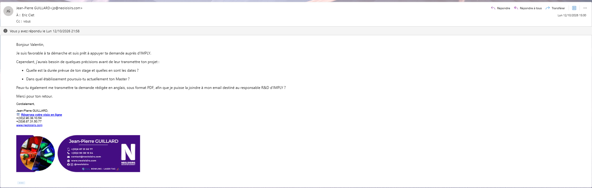

16/10/2026
BALBINE Valentin

**Week Report 2**  

This week i mainly send and reply to email to 2 company.

I got an answer from Mr Guiillard which is responsible from NeoLoisir / Neo entertainment and who have a direct link with the company that i want ask access to their code for the bowling project.

On the other  side , i start the discussion with a coach from the Montpellier F.C that is the new women professionnal football club (i.e Previously MHSC féminine) to ask if he could be interesting for him to get an intern who can assist him in training and doing the master's internship.
So i pitch a bit then i create a document("Proposition de stage pour un M1") where i refer everything to show him my skills and my possibilities.
mar

Even if the discussion is going well nothing it's done so i prepare an alternative solutions in case somenthing won't work.

